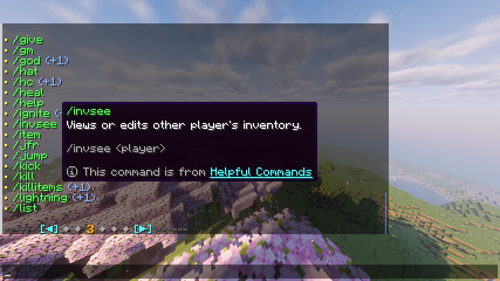
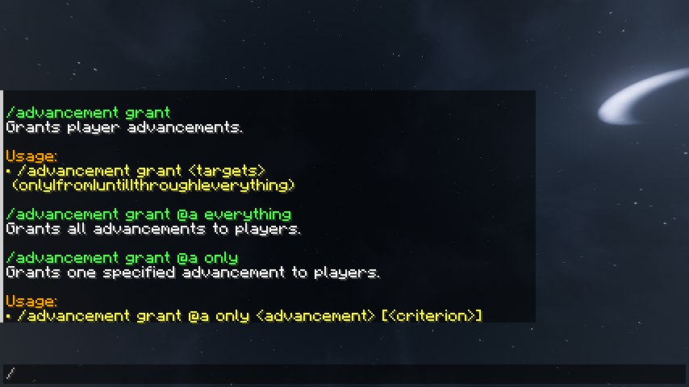
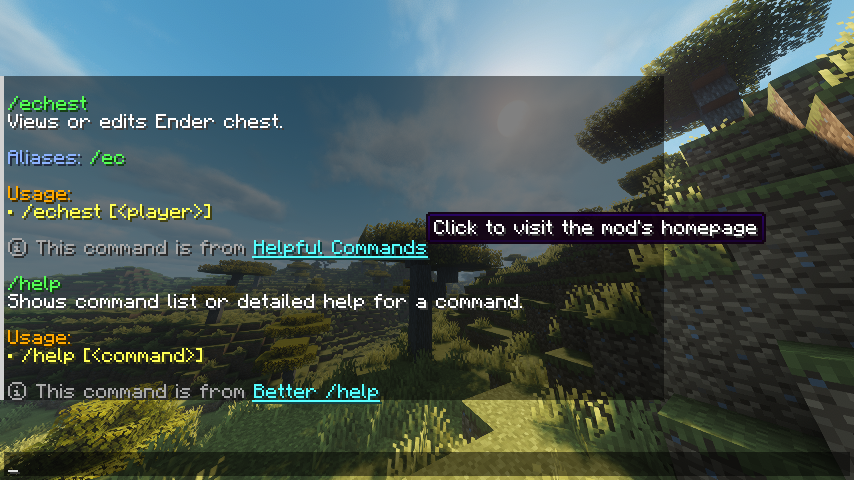

<p align="center">
    
</p>

<p align="center">
  <strong>A Minecraft mod that replaces <code>/help</code> with a clearer, interactable, paginated list.<br>
  Adds descriptions for commands and arguments, plus optional metadata from other mods.</strong>
</p>

<p align="center">
  <a href="https://betterhelp.expecticament.com"></a>
  <a href="https://github.com/expecticament/better-help"></a>
  <a href="https://modrinth.com/mod/better-help"></a>
  <a href="https://www.curseforge.com/minecraft/mc-mods/better-help"></a>
  <a href="https://ko-fi.com/expecticament"></a>
</p>

***

<p align="center">
    
</p>

## ✨ Features

Vanilla `/help` throws a hard-to-read wall of text at you with almost no useful detail. **Better /help** replaces it with something players can actually use.

- **Clear, paginated command list**: browse commands page by page instead of scrolling through a wall of text
- **Interactive output**: hover for details and click to navigate pages
- **Descriptions for commands and arguments**: most vanilla commands are covered, and arguments can have their own descriptions too
- **Simple mod integration**: other mods can add descriptions and metadata (like homepage links) using only their language files
- **Attribution**: when a description comes from another mod, players can see which mod the command is from
- **Suggestions**: `/help <command...>` autocompletes like typing the command itself, unlike vanilla `/help`
- **Server-side**: no client installation needed

## ⌨️ Usage

- `/help` - displays the paginated command list
- `/help <command...>` - shows help for a command or argument

Examples:

```text
/help
/help gamemode
/help advancement grant @s everything
```

## 🖼️ Screenshots
<p align="center">
  
  
  
</p>

## 💻 For mod developers

Add descriptions with your mod's language files - no dependency or API needed:

```json
{
  "examplemod.commands.examplecommand.description": "Description of your command.",
  "examplemod.commands.examplecommand.arg1.description": "Description of your argument."
}
```

> More details like key formats, argument paths, aliases and homepage link are covered in the [developer documentation](https://betterhelp.expecticament.com/docs/For%20Developers/Basics).

## ❓ FAQ

**If Better /help is installed on a server, do players also need to install it?**<br>
No. It is a server-side mod. Clients do not need it.

**Does it work in singleplayer?**<br>
Yes.

**Will commands from other mods still show if the developer did not integrate with Better /help?**<br>
Yes, but without their descriptions or other metadata. Usage is still shown.

**Can I include it in a modpack?**<br>
Yes. No need to ask for permission.

## 🔨 How to build

Requirements: a compatible JDK (see `java_version` in `gradle.properties`). [Eclipse Temurin](https://adoptium.net/) is recommended.

```bash
./gradlew build
```

Where to find the jars:

| Loader   | Output                 |
|----------|------------------------|
| Fabric   | `fabric/build/libs/`   |
| NeoForge | `neoforge/build/libs/` |
